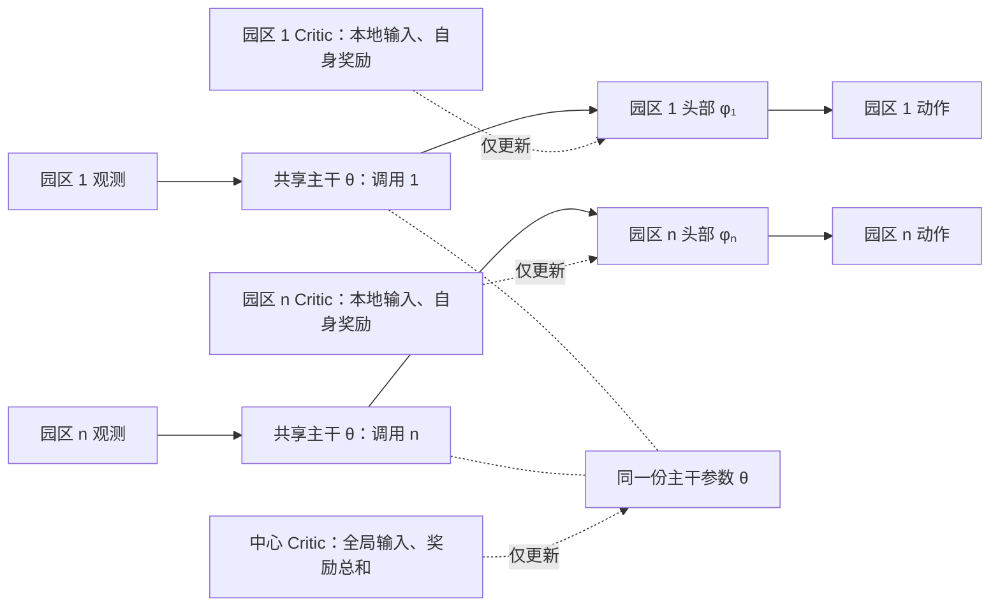

# DDPG：共享主干与园区专属头部

每个园区单独执行 `a_i = head_i(backbone(o_i))`。各园区复用同一份主干参数，
观测维度及字段语义必须一致；动作维度可以不同。Actor 不读取其他园区观测。

图中实线为本地动作生成路径，带箭头的虚线为参数更新关系。
中心 Critic 读取同一时刻的联合观测和动作。
园区 Critic 仅读取本园区观测和动作，分别拟合自身回报；它们是独立网络，
目前仍在同一个训练进程执行，不涉及跨设备通信。

## 优化顺序

1. 从共享回放池读取 `(s, a, [r₁,…,rₙ], s', done)`。
2. 用目标 Actor 分别生成下一步本地动作，拼接为 `a'`。
3. 中心 Critic 拟合 `Σrᵢ + γ(1-done)Q'_G(s',a')`；
   园区 Critic 拟合 `rᵢ + γ(1-done)Q'_i(o'_i,a'_i)`。
4. 固定头部和中心 Critic 参数，以 `-mean(Q_G(s,a))` 更新主干。
   保留头部对输入的导数，梯度穿过固定头部回到主干。
5. 用新主干在无梯度模式下重新生成各园区特征。
   园区 i 以 `-mean(Q_i(o_i,head_i(feature_i)))` 更新自身头部。
   本步骤不需要其他园区动作，也不更新主干或其他头部。
6. 对 Actor、中心 Critic 和全部园区 Critic 目标网络做软更新。

两种 actor 更新使用独立 optimizer。中心 Critic 不直接更新头部，
园区 Critic 不更新主干，因此不保证每次局部头部更新都改善全局回报。
终止掩码沿用原环境的系统级 `done`，适用于各园区同步结束的场景。

## 接口和权重

- `actor(local_obs, agent_index)` 只返回指定园区动作。
- `select_local_action(...)` 用于本地执行；训练入口按园区分别调用。
- `select_action(joint_state, ...)` 保留兼容入口，在内部拆分观测、分别调用本地策略。
- 保存文件为 `actor.pth`、`critics.pth`、`global_critic.pth`；仅保存模型权重，
  不保存回放池和 optimizer 状态。加载时同步目标网络。
- 原全局融合 Actor 的旧权重不兼容，需要重新训练。
- 园区 Critic 改为本地输入后，旧版全局输入的园区 Critic 权重维度不兼容。
- 训练奖励保存至 `result/CentralizedActor/result_arrays.npz`，键为 `DDPG`，
  数组维度为园区数 × 回合数；再次训练会覆盖该文件。直接调用及主入口串行、
  并行训练均使用此目录。模型权重仍保存于 `model_pth/ddpg`。

